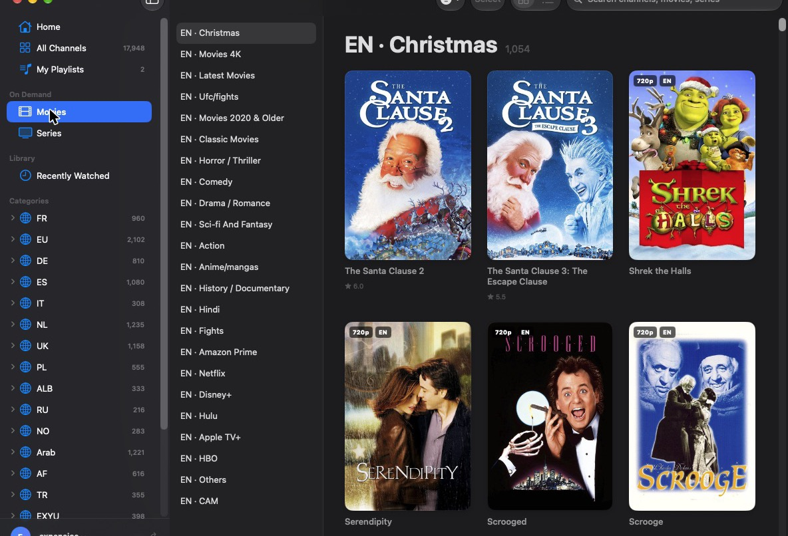
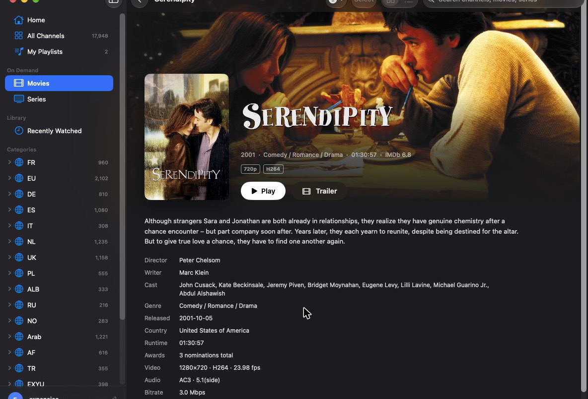

<p align="center">
  
</p>

<h1 align="center">Open IPTV</h1>

<p align="center">
  A fast, native macOS player for your IPTV subscription.<br>
  Xtream Codes or M3U · live TV, movies and series · an Apple TV–style interface · a player that shows the picture and nothing else.
</p>

<p align="center">
  <a href="https://github.com/BaraaAwwad/open-iptv/releases/latest"><b>Download for Mac</b></a> ·
  <a href="#features">Features</a> ·
  <a href="#keyboard">Keyboard</a> ·
  <a href="#build-from-source">Build from source</a> ·
  <a href="SECURITY.md">Security</a>
</p>





## Download

1. Download the latest **`Open-IPTV-x.y.z.dmg`** from [Releases](https://github.com/BaraaAwwad/open-iptv/releases/latest) and drag **Open IPTV** to Applications.
2. The first time, **right-click the app → Open → Open**. Builds are signed but not yet notarized by Apple, so macOS asks once.
3. Add your provider: an Xtream Codes server + username + password, or an M3U playlist URL.

Requires macOS 15 or later on Apple silicon (M1 or newer). Everything the player needs is inside the app.
Optional: `brew install ffmpeg` enables AirPlay to TVs and the quality checks.

Verify a download against `SHA256SUMS.txt` on the release page:

```bash
shasum -a 256 -c SHA256SUMS.txt
```

## Features

**Live TV**
- Thousands of channels load instantly (cached on disk, refreshed in the background every 12 hours or with ⌘R).
- Categories grouped by country / prefix, filler "channels" hidden, `|UK|`-style tags removed, ALL-CAPS names title-cased.
- Grid or list view, arrow-key navigation, type anywhere to search.
- **Measured quality**, never guessed from names: channels you watch are measured automatically, and **Check Quality** scans a category one channel at a time, only while nothing is playing.

**Movies & Series**
- Your provider's on-demand library with posters, backdrops, plot, cast, runtime and the file's real resolution, HDR, codecs and bitrate.
- Optional online details from [Cinemeta](https://v3-cinemeta.strem.io), the public catalogue Stremio uses: title logos, IMDb ratings, awards, trailers, and episode stills, names and summaries. No account needed; turn it off in Settings.
- Filters (toolbar): quality and language. Continue Watching with resume, Latest Movies and Latest Series on Home.

**Player** (mpv with hardware decoding)
- Picture in picture: a small native window you can resize and move. **Real** macOS full screen.
- Live: channel up / down, a LIVE badge that turns into **Go Live** after a pause or stall, now / next from the guide.
- On demand: scrubber, ±10 s skip, resume where you left off.
- **AirPlay** to Apple TV and AirPlay TVs (the stream is repackaged to HLS on the fly).
- **Stream Info** (I): resolution, codecs, frame rate, bitrate, colour / HDR, buffer, download speed, dropped frames.
- Handles providers that allow one connection at a time: channel switching waits until you settle, reconnects are capped, and a refused stream is retried once.

**Everything else**
- Search across channels, movies and series at once.
- My Playlists: Favorites plus your own lists, bulk add and remove with Select.

## Keyboard

| Where | Key | Action |
| --- | --- | --- |
| Browsing | Arrows, Return | Move, play |
| Browsing | Just type | Search (Backspace edits, Esc clears) |
| Browsing | ⌘1 / ⌘2 | Grid / list |
| Anywhere | ⌘↩ | Full screen ↔ picture in picture |
| Anywhere | ⌘. | Stop |
| Anywhere | ⌘↑ / ⌘↓ | Previous / next channel |
| Anywhere | ⌘L | Go Live |
| Full screen | Space, M, I, S | Pause, mute, stream info, favorite |
| Full screen | ↑ / ↓ · ← / → | Channel (live) or volume (movies) · volume (live) or ±10 s (movies) |
| Full screen | Esc | Back to picture in picture |

## Privacy

- Your playlists and logins stay on your Mac, in `~/Library/Application Support/Open IPTV/sources.json` (readable only by you). Nothing is sent anywhere except to your provider.
- Stream addresses contain your password, so they are never written to caches or logs. The diagnostics log (`~/Library/Logs/Open IPTV/player.log`) records channel ids only.
- With online info on, only the title you open is looked up on Cinemeta.

## Build from source

```bash
brew install mpv xcodegen
xcodegen generate
open OpenIPTV.xcodeproj          # or: scripts/install.sh  (Release build into /Applications)
```

`scripts/release.sh <version>` produces the self-contained download (libmpv and its libraries bundled, signed, DMG + ZIP + checksums). With a Developer ID certificate and an App Store Connect API key in `NOTARY_KEY_PATH` / `NOTARY_KEY_ID` / `NOTARY_ISSUER`, it also notarizes.

## License

[MIT](LICENSE). Open IPTV is a player only: it ships no channels, playlists or content. Use it with a subscription you're entitled to.
